# Activité pratique - Programmation orientée aspect

Cette activité présente la programmation orientée aspect (**AOP**) avec
AspectJ et Spring AOP. Elle est organisée en trois parties :

- les parties 1 et 2 sont regroupées dans `src/main/java` ;
- la partie 3 est un projet Spring autonome dans `Partie3/app_springAOP` ;
- les captures d'écran sont classées dans `media/partie1`, `media/partie2`
  et `media/partie3`.

## Partie 1 - Premiers aspects AspectJ

Cette partie montre deux syntaxes pour intercepter l'exécution de la méthode
`main` :

- `FirstAspect.aj` utilise la syntaxe native AspectJ ;
- `SecondAspect.java` utilise les annotations `@Aspect`, `@Pointcut` et
  `@Around`.

Dans les deux cas, un conseil `around` affiche un message avant et après
l'exécution de l'application.

### Éléments principaux

- `Partie1.aspect.FirstAspect` : aspect écrit en syntaxe AspectJ ;
- `Partie1.aspect.SecondAspect` : aspect écrit avec les annotations ;
- `Partie1.test.Application` : application utilisée pour vérifier
  l'interception.

### Captures

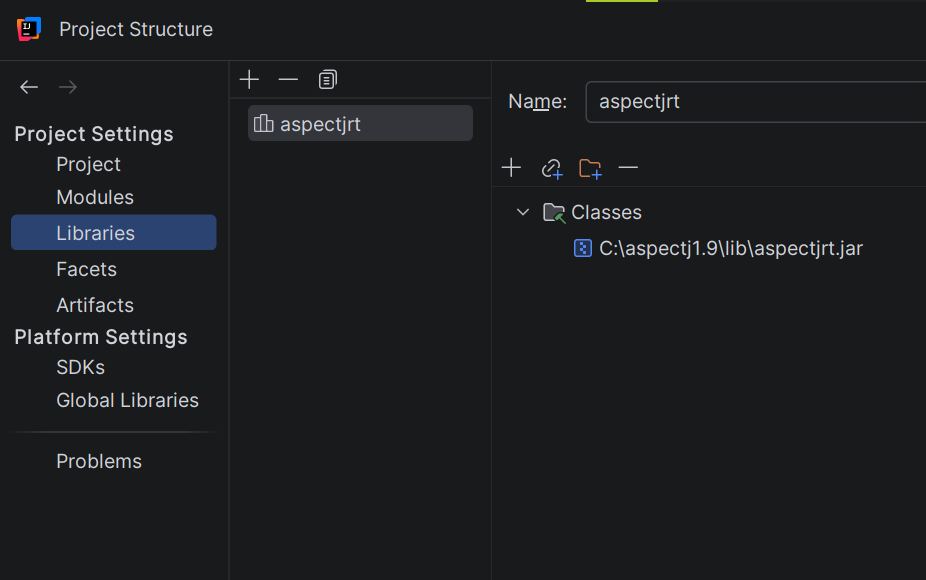

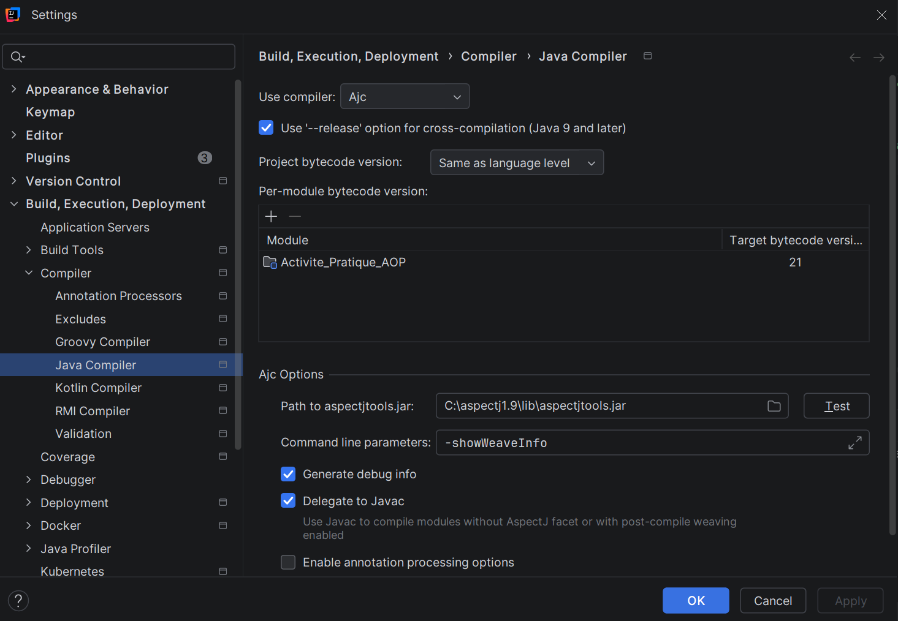

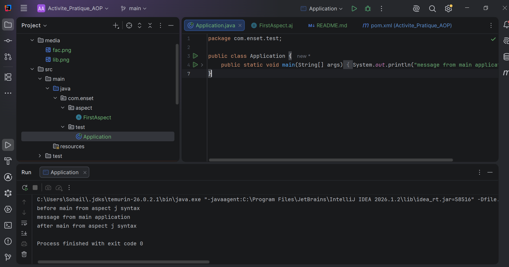

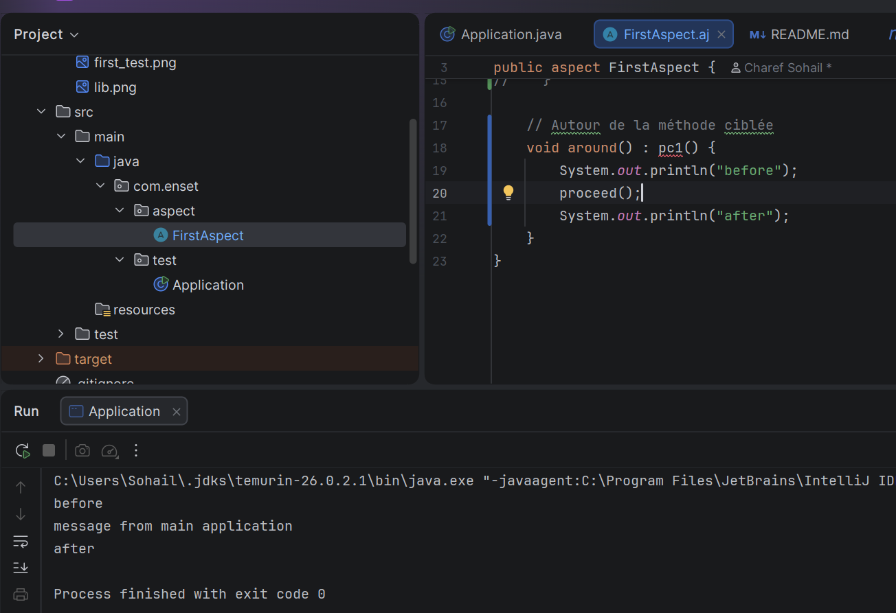

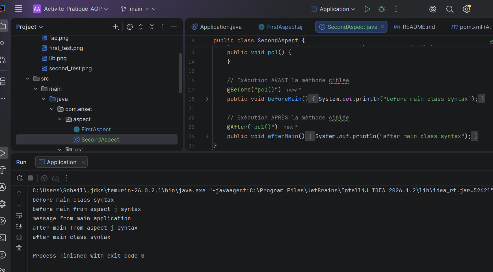

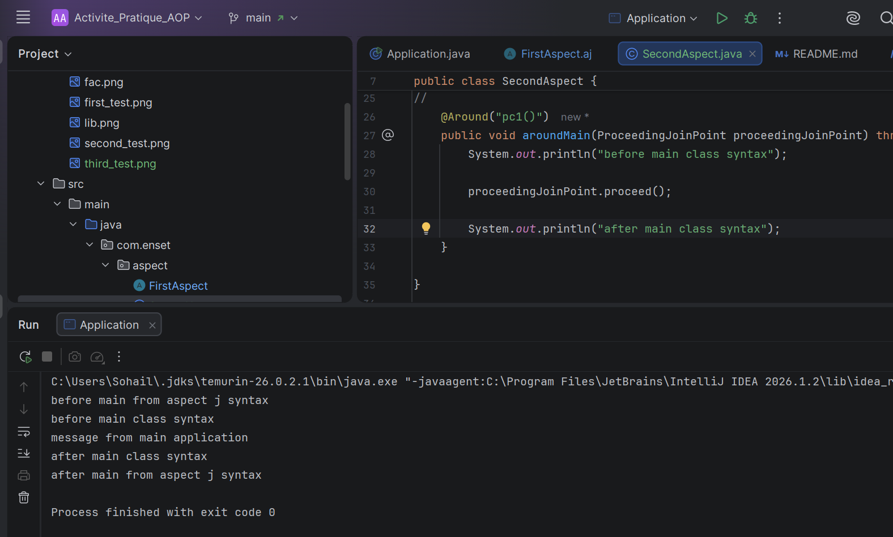

## Partie 2 - Aspects appliqués à une application bancaire

Cette partie applique des aspects à une application de gestion de comptes
bancaires :

- `LogAspect` journalise l'appel, le retour et la durée d'exécution des
  méthodes métier dans `log.xml` ;
- `PatchRetraitAspect` empêche un retrait lorsque le solde est insuffisant ;
- `SecurityAspect` protège le démarrage de l'application par une
  authentification.

Le métier bancaire est défini par `IMetierBanque` et implémenté par
`MetierImpl`. La classe `Partie2.test.Application` permet de tester les
versements, les retraits et la consultation du compte.

### Captures

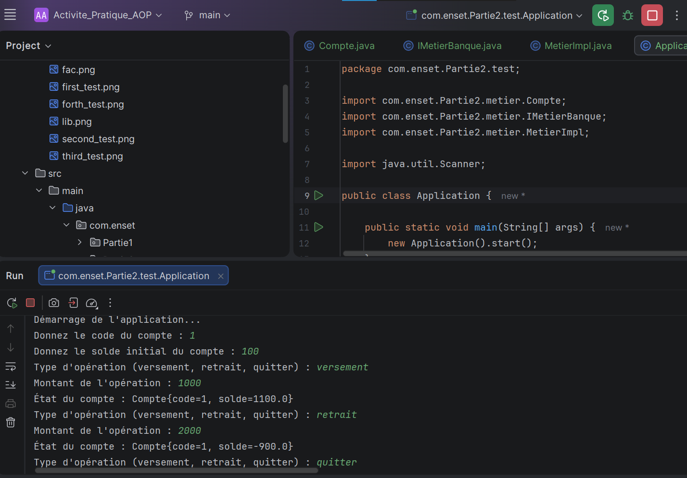

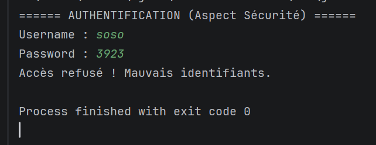

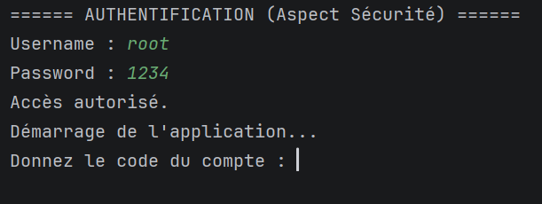

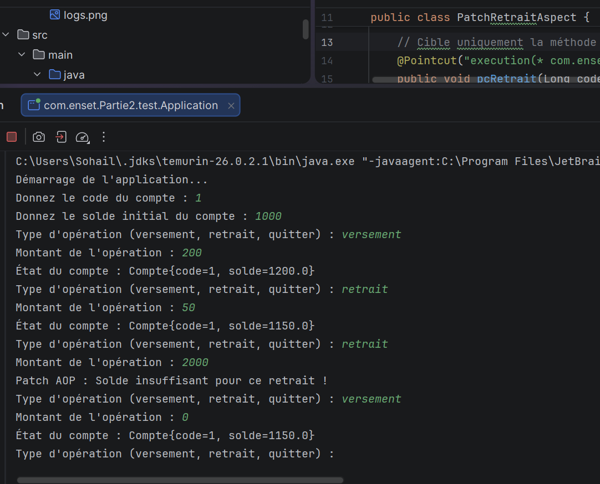

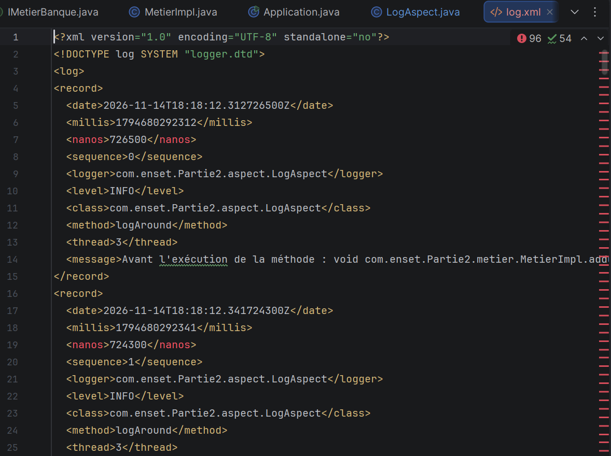

## Partie 3 - Spring AOP et autorisation par annotation

La troisième partie se trouve dans `Partie3/app_springAOP`. Elle utilise le
conteneur Spring pour détecter les composants et créer automatiquement les
proxies AOP.

L'application définit deux annotations et aspects :

- `@SecuredByAspect` déclare les rôles nécessaires à l'exécution d'une
  méthode ;
- `AuthorizationAspect` vérifie les rôles présents dans `SecurityContext` ;
- `@Log` et `LogAspect` ajoutent la journalisation autour des méthodes métier.

`MetierImpl` expose deux opérations :

- `process()` est accessible avec le rôle `USER` ou `ADMIN` ;
- `compute()` nécessite le rôle `ADMIN`.

La classe `Application` exécute les deux scénarios avec un utilisateur `USER`,
puis avec un utilisateur `ADMIN`.

### Exécution

Depuis le dossier `Partie3/app_springAOP` :

```bash
mvn compile
```

Le point d'entrée de la démonstration est `com.enset.Application`.

### Captures

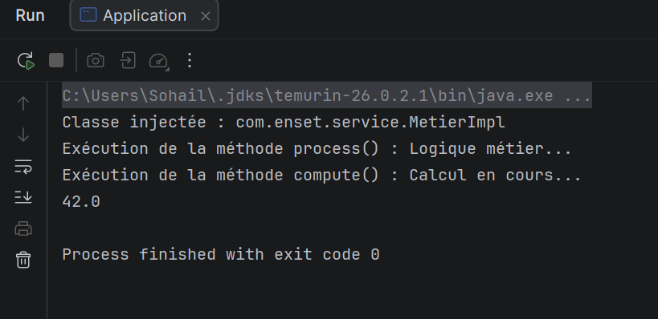

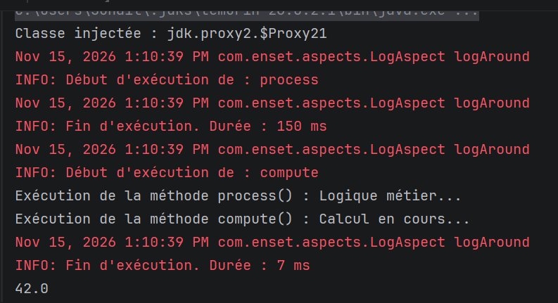

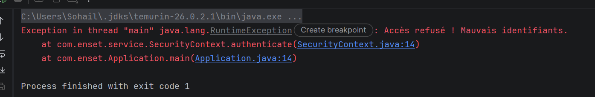

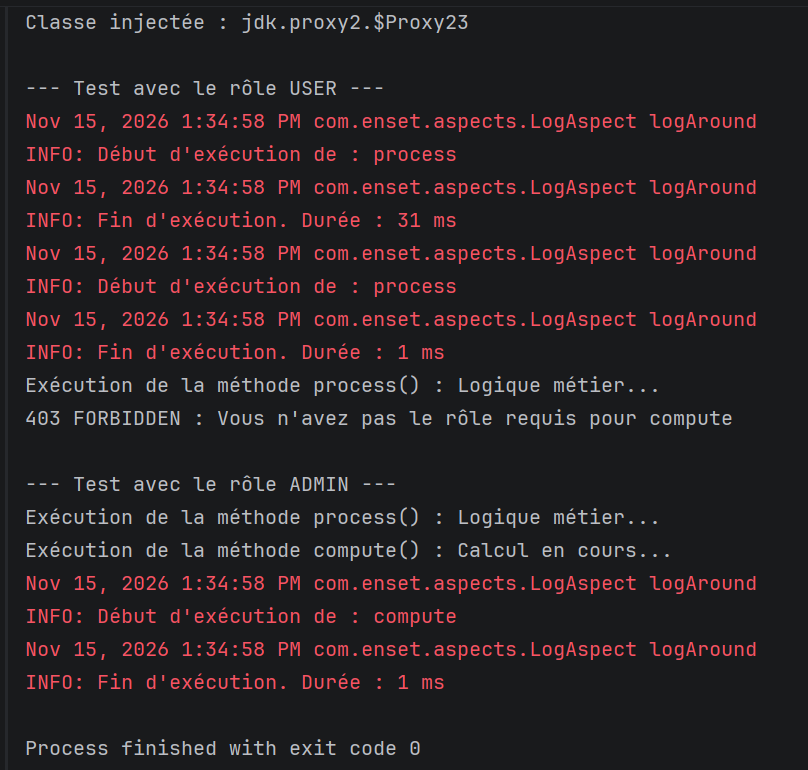