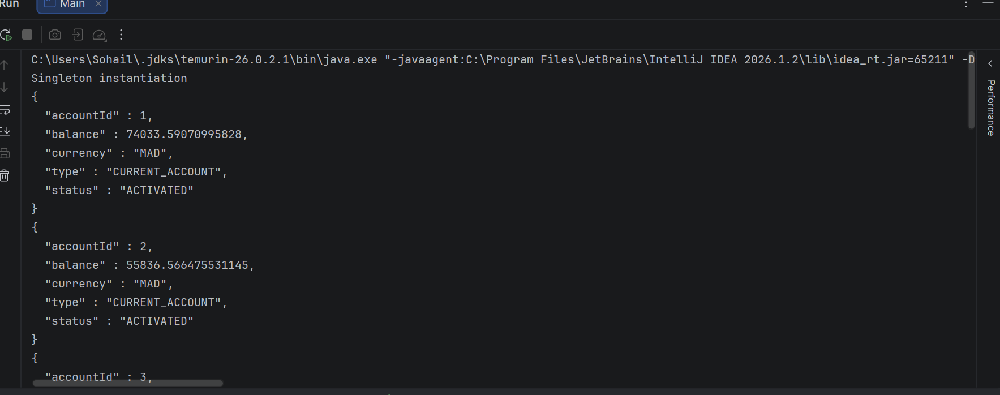
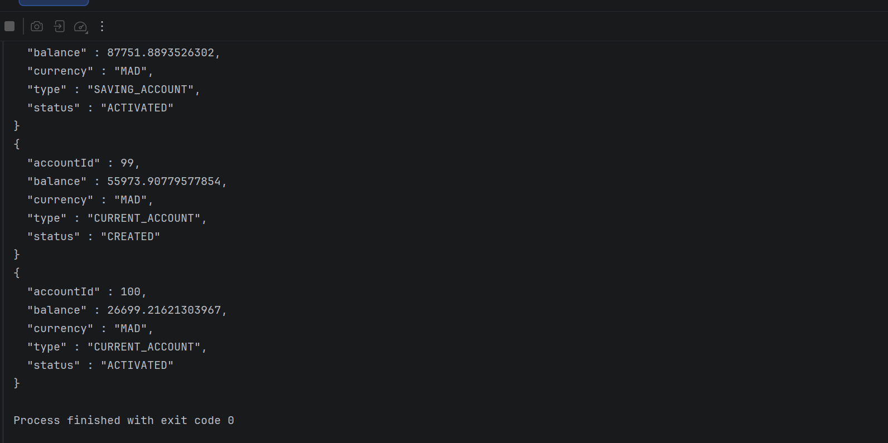
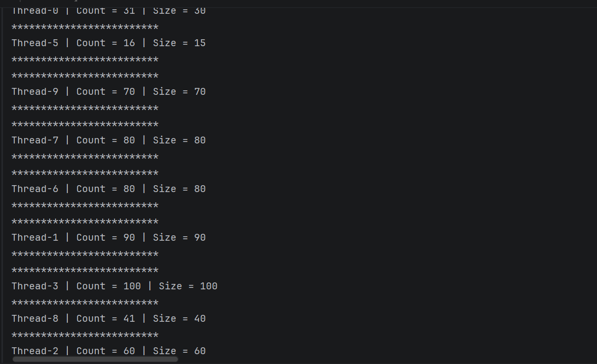
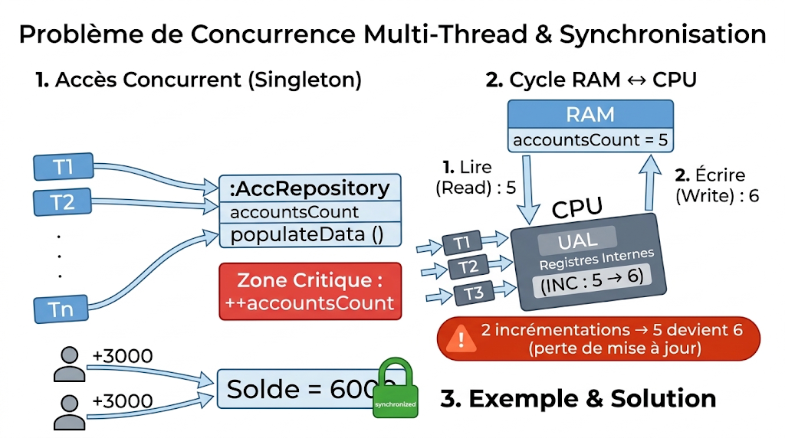
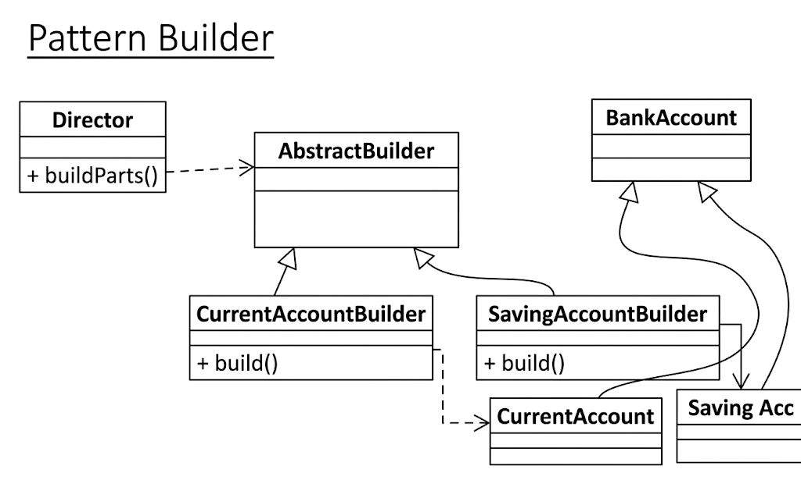
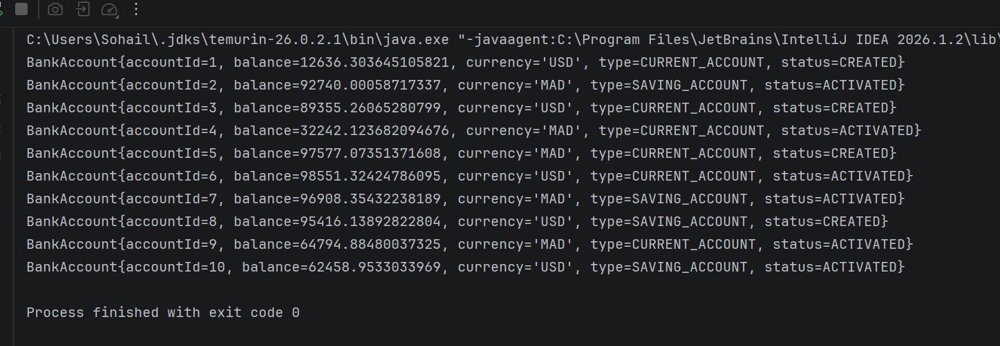
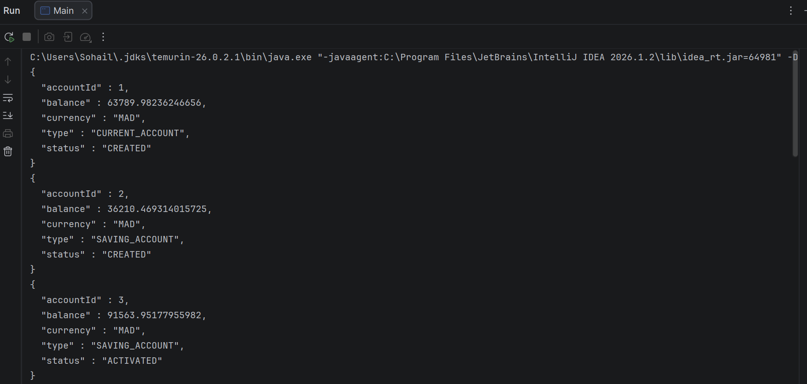
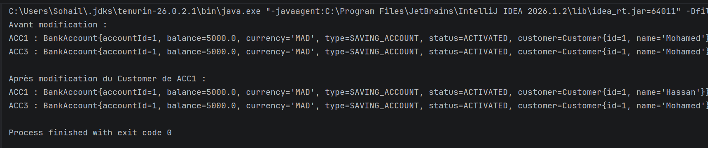

# Design Patterns - Singleton, Builder et Prototype

Ce projet met en œuvre trois Design Patterns autour d'une application de
gestion de comptes bancaires : **Singleton**, **Builder** et **Prototype**.
Les comptes peuvent être construits progressivement, clonés avec leurs
données imbriquées et enregistrés dans un repository partagé entre plusieurs
threads.

## Modèle métier

`BankAccount` représente un compte bancaire avec :

- un identifiant et un solde ;
- une devise (`MAD` ou `USD`) ;
- un type (`CURRENT_ACCOUNT` ou `SAVING_ACCOUNT`) ;
- un statut (`CREATED`, `ACTIVATED`, `SUSPENDED` ou `BLOCKED`) ;
- un `Customer` associé.

Les classes `AccountType` et `AccountStatus` définissent respectivement les
types et les états possibles d'un compte.

## Singleton - repository partagé

`AccountRepositoryImpl` est implémenté comme un Singleton :

- son constructeur est privé ;
- son instance unique est créée statiquement ;
- `getInstance()` fournit l'accès au repository partagé.

Le repository centralise les opérations `save`, `findAll`, `findById`,
`searchAccounts`, `update` et `deleteById`. La génération des identifiants et
les écritures dans la `HashMap` sont protégées par des blocs `synchronized`
afin de supporter la création de comptes par plusieurs threads.









## Builder - construction des comptes

`BankAccount.AccountBuilder` permet de créer un compte étape par étape grâce
aux méthodes `accountId`, `balance`, `currency`, `type` et `status`. La méthode
`build()` retourne le compte construit.

`BankDirector.accountBuilder()` fournit un point d'entrée lisible pour créer
un builder :

```java
BankAccount account = BankDirector.accountBuilder()
        .balance(5000)
        .currency("MAD")
        .type(AccountType.SAVING_ACCOUNT)
        .status(AccountStatus.ACTIVATED)
        .build();
```







## Prototype - clonage profond

`BankAccount` implémente `Cloneable`. Sa méthode `clone()` copie le compte et
clone également le `Customer` associé. Il s'agit donc d'une copie profonde
pour cette relation : modifier le client du compte original ne modifie pas
celui du compte cloné.

La démonstration `TestPrototype` construit un compte, lui associe un client,
crée un clone, puis modifie le nom du client original pour vérifier
l'indépendance des deux objets.



## Exécution

`com.enset.Main` récupère l'instance unique du repository, lance dix threads
qui ajoutent chacun dix comptes, puis affiche les comptes enregistrés au
format JSON avec `JsonSerializer`.

`com.enset.TestPrototype` lance la démonstration du pattern Prototype.

Depuis le dossier `DP_Singleton_Builder_Prototype`, compiler le projet avec
Maven :

```bash
mvn compile
```