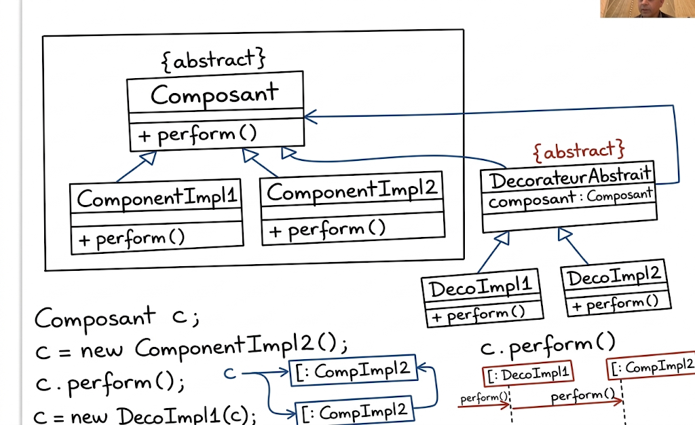
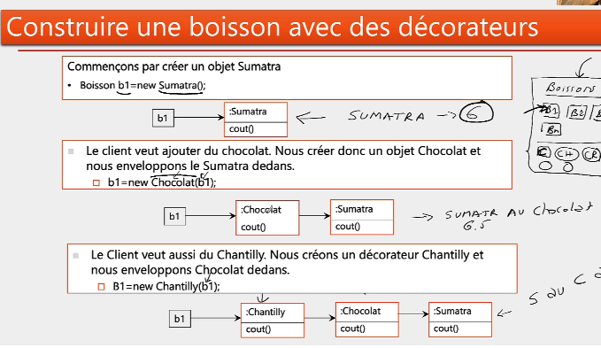

# Design Pattern Decorator

## Catégorie : Structure

Le pattern **Decorator** permet d'ajouter dynamiquement des responsabilités ou des fonctionnalités à un objet, en l'enveloppant dans un ou plusieurs décorateurs. Il offre une alternative flexible à l'héritage pour étendre le comportement d'un objet.

## Objectifs

- Ajouter dynamiquement des fonctionnalités à un objet.
- Empiler plusieurs décorateurs autour d'un même composant.
- Respecter une interface commune entre le composant et ses décorateurs.
- Éviter la multiplication de sous-classes pour chaque combinaison de fonctionnalités.

## Raison d'utilisation

Un objet doit pouvoir être enrichi progressivement et de manière flexible, sans modifier sa classe d'origine. Les fonctionnalités peuvent être combinées dans l'ordre souhaité au moment de l'exécution.

## Résultat

Le composant de base et les décorateurs partagent le même type abstrait. Chaque décorateur conserve une référence vers un composant et lui délègue le comportement de base avant ou après l'ajout de sa propre fonctionnalité.

## Médias

### Diagramme général du pattern Decorator



### Exemple de construction d'une boisson avec des décorateurs



## Structure de l'implémentation

- `Boisson` : composant abstrait définissant la description et le coût.
- `Espresso` et `Sumatra` : composants concrets représentant les boissons de base.
- `AbstractDecorateur` : décorateur abstrait qui conserve une référence vers une boisson.
- `Chocolat` : ajoute la garniture chocolat et `1.2` au coût.
- `Caramel` : ajoute la garniture caramel et `0.8` au coût.
- `Main` : démontre l'empilement de plusieurs décorateurs.

## Fonctionnement de l'exemple

1. Une boisson `Sumatra` est créée pour un coût de `6.0`.
2. Le décorateur `Chocolat` est ajouté, ce qui donne un coût de `7.2`.
3. Le décorateur `Caramel` est ajouté à son tour, pour un coût de `8.0`.
4. Plusieurs décorateurs peuvent aussi être chaînés directement dans une seule expression.

```java
Boisson boisson = new Chocolat(new Caramel(new Chocolat(new Sumatra())));
```

## Exécution

Depuis le dossier `DP_decorator`, compiler le projet avec Maven :

```bash
mvn compile
```

Le point d'entrée de la démonstration est la classe `Main`.
