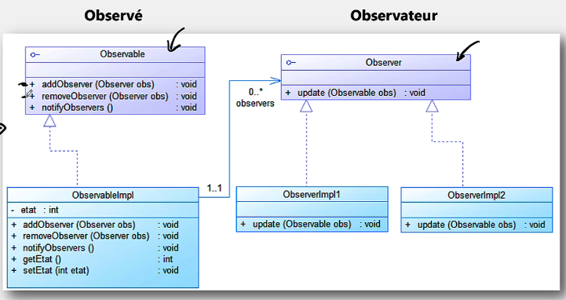
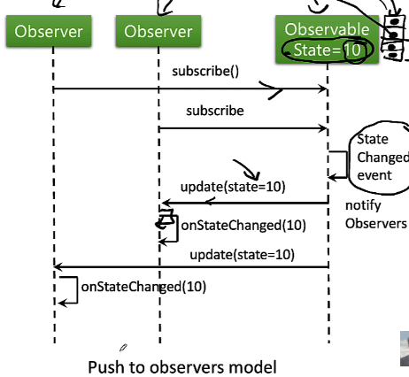
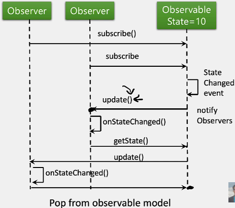
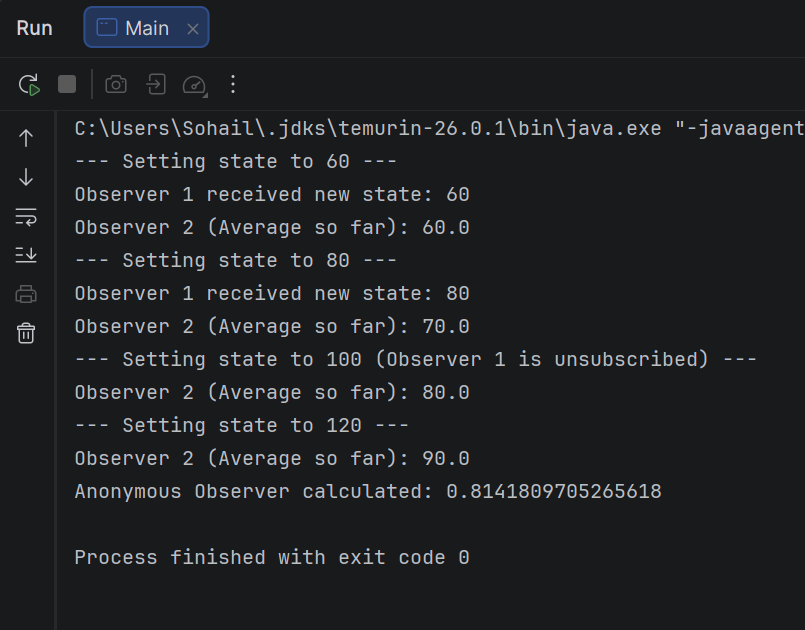

# Design Pattern Observer

## Catégorie : Comportement

Le pattern **Observer** définit une relation de dépendance entre un objet, appelé **sujet** ou **observable**, et plusieurs objets, appelés **observateurs**. Lorsqu'une modification intervient dans l'état du sujet, tous les observateurs abonnés sont automatiquement notifiés.

## Objectifs

- Définir une dépendance entre un sujet et plusieurs observateurs.
- Notifier automatiquement les observateurs lorsqu'un état change.
- Permettre l'ajout ou la suppression d'observateurs dynamiquement.
- Limiter le couplage entre le sujet et les objets qui réagissent à ses changements.

## Raison d'utilisation

Un objet doit informer plusieurs autres objets d'une modification de son état, sans connaître les détails de leurs traitements. Les observateurs peuvent ainsi réagir chacun de manière différente au même événement.

## Résultat

Le sujet centralise la gestion des abonnements et des notifications, tandis que chaque observateur encapsule son propre comportement. Les observateurs peuvent être ajoutés ou retirés sans modifier l'implémentation du sujet.

## Structure de l'implémentation

- `Observable` : interface définissant les opérations d'abonnement, de désabonnement et de notification.
- `ObservableImplementation` : sujet concret qui maintient son état et la liste des observateurs.
- `Observer` : interface commune contenant la méthode `update`.
- `ObserverImplementation1` : affiche le nouvel état reçu.
- `ObserverImplementation2` : conserve l'historique des états et calcule leur moyenne.
- `Main` : démontre les abonnements, les notifications, le désabonnement et l'utilisation d'un observateur lambda.

## Fonctionnement de l'exemple

1. Deux observateurs s'abonnent au sujet.
2. Le changement d'état à `60`, puis à `80`, notifie les deux observateurs.
3. `ObserverImplementation1` est désabonné.
4. Le changement d'état à `100` ne notifie plus que `ObserverImplementation2`.
5. Un observateur anonyme est ajouté avant le changement d'état à `120`.

## Médias

### Diagramme de classes



### Modèle Push

Dans le modèle Push, le sujet transmet directement les données modifiées aux observateurs lors de la notification.



### Modèle Pull

Dans le modèle Pull, les observateurs sont avertis du changement puis récupèrent eux-mêmes l'état auprès du sujet.



### Exécution



## Exécution

Depuis le dossier `DP_observer`, compiler le projet avec Maven :

```bash
mvn compile
```

Le point d'entrée de la démonstration est la classe `Main`.
