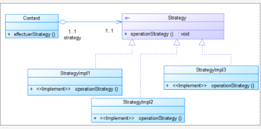

# Design Pattern Strategy

## Catégorie : Comportement

Le pattern **Strategy** définit une famille d'algorithmes, encapsule chacun d'eux et les rend interchangeables. Chaque algorithme peut ainsi évoluer indépendamment des clients qui l'utilisent.

## Objectifs

- Définir une famille d'algorithmes.
- Encapsuler chaque algorithme.
- Rendre les algorithmes interchangeables.
- Permettre à chaque algorithme d'évoluer indépendamment des clients qui l'utilisent.

## Raison d'utilisation

Un objet doit pouvoir faire varier dynamiquement une partie de son algorithme.

## Résultat

Le Design Pattern Strategy permet d'isoler les algorithmes appartenant à une même famille d'algorithmes. Le contexte utilise alors la stratégie adaptée sans dépendre directement de l'implémentation concrète.

## Diagramme UML

## Implémentation

Ce TP contient notamment :

- `Strategy` : l'interface commune aux stratégies.
- `M1StrategyImpl`, `M2StrategyImpl`, `M3StrategyImpl` et `MDefaultStrategyImpl` : les implémentations concrètes.
- `Context` : la classe qui utilise une stratégie interchangeable.
- `Main` : le point d'entrée de l'application.
