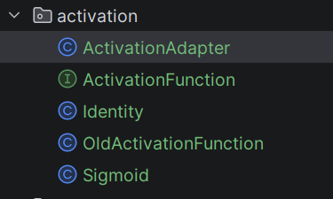
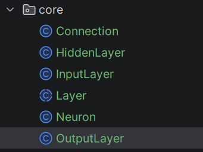
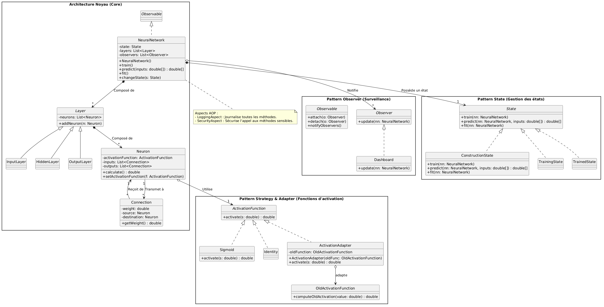
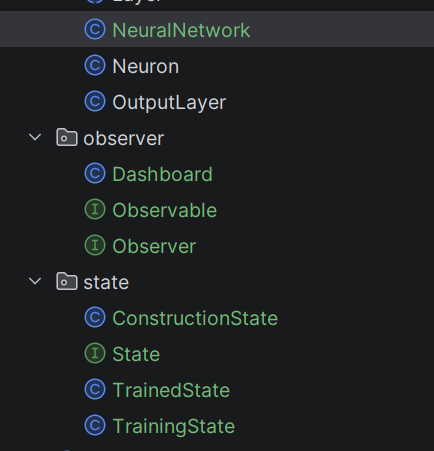
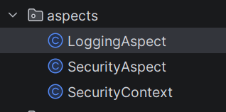
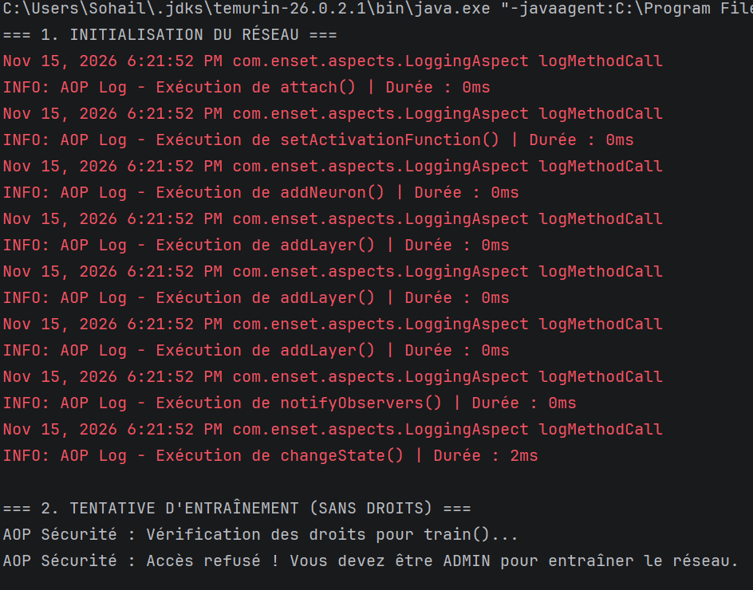
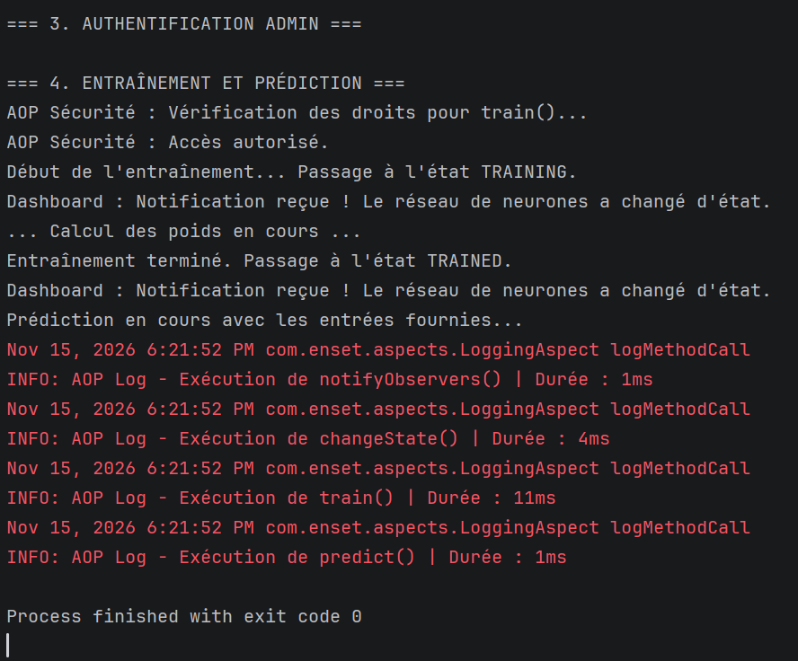

# Examen - Design Patterns

Cet examen met en œuvre plusieurs Design Patterns dans une application de
réseau de neurones. Le projet se trouve dans `Examen_Design_Pattern` et
contient également des aspects AspectJ pour la journalisation et la sécurité.

## Objectif

L'application construit un réseau composé de couches et de neurones, contrôle
son cycle de vie et protège l'entraînement par une vérification du rôle
`ADMIN`. Elle permet ensuite d'effectuer une prédiction après l'entraînement.

## Patterns utilisés

### Strategy - fonctions d'activation

`ActivationFunction` définit l'interface commune des fonctions d'activation.
`Sigmoid` et `Identity` sont des implémentations interchangeables utilisées
par `Neuron`.

L'ancienne interface `OldActivationFunction` est rendue compatible avec cette
interface grâce à `ActivationAdapter`.



### Composite - structure du réseau

`NeuralNetwork` contient une collection de `Layer`, tandis que chaque couche
contient des `Neuron`. Cette organisation permet de structurer le réseau en
éléments composés :

- `InputLayer`, `HiddenLayer` et `OutputLayer` représentent les couches ;
- `Neuron` représente les éléments individuels ;
- `Connection` représente les liens pondérés entre neurones.





### State - cycle de vie du réseau

`NeuralNetwork` délègue les opérations à l'état courant :

- `ConstructionState` autorise le démarrage de l'entraînement ;
- `TrainingState` bloque les opérations incompatibles pendant l'entraînement ;
- `TrainedState` autorise la prédiction et signale qu'un nouvel entraînement
  nécessite une réinitialisation.

Chaque changement d'état notifie les observateurs associés.



### Observer - tableau de bord

`NeuralNetwork` implémente `Observable` et notifie ses `Observer` lorsqu'il
change d'état. `Dashboard` observe le réseau et affiche une notification à
chaque transition.

Le diagramme des états et observateurs est présenté dans
`media/observer_state_NN.png`.

## Aspects

Deux aspects transversaux complètent l'application :

- `LoggingAspect` intercepte les méthodes du package `com.enset.core` et
  journalise leur durée d'exécution ;
- `SecurityAspect` intercepte `NeuralNetwork.train()` et autorise
  l'entraînement uniquement lorsque `SecurityContext` contient le rôle
  `ADMIN`.



## Déroulement de l'application

`com.enset.Application` :

1. crée le réseau et attache le `Dashboard` ;
2. ajoute les couches et un neurone utilisant la stratégie `Sigmoid` ;
3. tente un entraînement sans authentification, qui est refusé ;
4. authentifie l'utilisateur `root` avec le rôle `ADMIN` ;
5. entraîne le réseau puis lance une prédiction avec les entrées `0.5` et
   `0.8`.





## Compilation et exécution

Depuis le dossier `Examen_Design_Pattern` :

```bash
mvn compile
```

Le point d'entrée de l'application est `com.enset.Application`.
