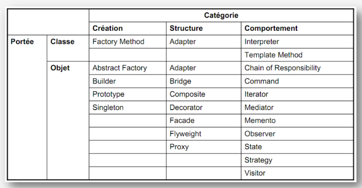

# TP DevOps - Design Patterns

Ce dépôt regroupe les travaux pratiques consacrés aux **Design Patterns**. Chaque dossier présente un pattern et son implémentation pratique.

## Classification GoF

Les Design Patterns du catalogue GoF sont répartis en trois catégories : création, structure et comportement.

## Travaux pratiques

| TP                                   | Description                                                                                                                                          |
| ------------------------------------ | ---------------------------------------------------------------------------------------------------------------------------------------------------- |
| [DP Strategy](DP_strategy/README.md) | Étude et implémentation du pattern comportemental **Strategy**, qui permet d'encapsuler une famille d'algorithmes et de les rendre interchangeables. |
| [DP Observer](DP_observer/README.md) | Étude et implémentation du pattern comportemental **Observer**, qui permet de notifier automatiquement plusieurs objets lorsqu'un état change.          |
