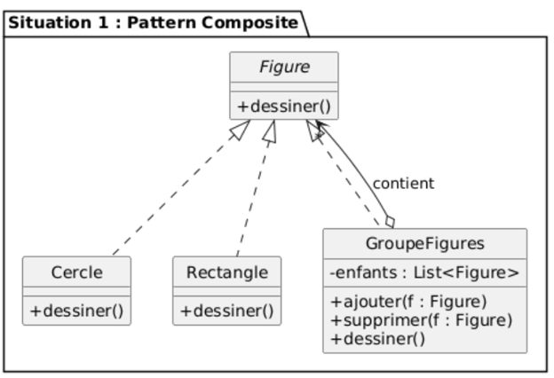
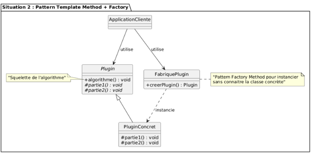
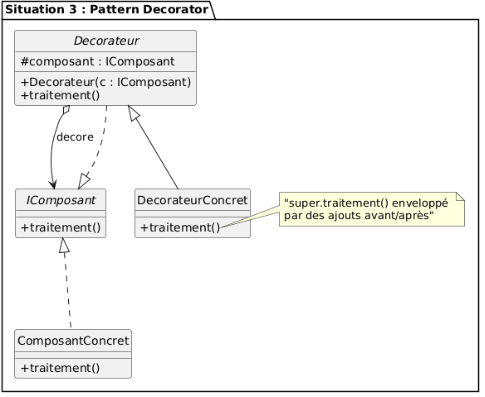
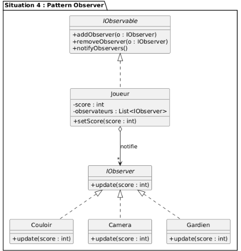
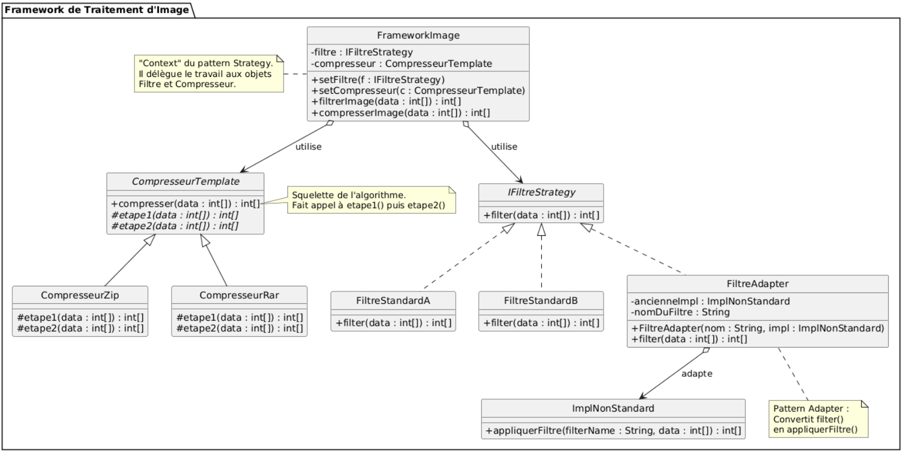
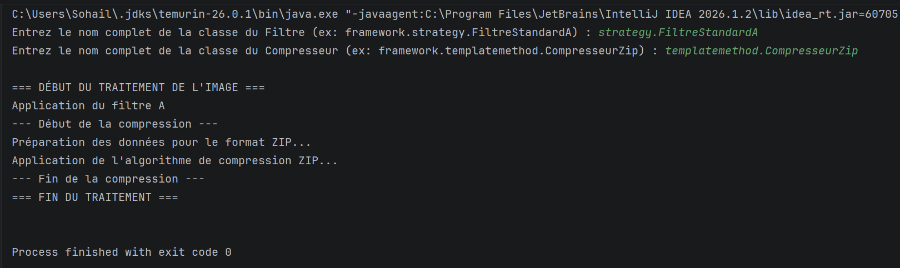

# Sohail Charef GLSID / TP Global - Design Patterns

Ce TP regroupe deux exercices de conception et d'implémentation de Design Patterns.

## Exercice 1 - Identification des Design Patterns

### Énoncé

Créer les diagrammes de classes en mentionnant les Design Patterns appropriés pour les situations suivantes :

1. Une figure peut être soit un cercle, un rectangle ou un groupe de figures.
2. Un plugin contient une opération implémentant le squelette d'un algorithme dont deux parties (`partie1` et `partie2`) sont variables. Le développeur doit pouvoir implémenter ces parties, tandis que l'application cliente doit pouvoir instancier une implémentation concrète sans connaître sa classe.
3. Un composant implémente une interface définissant `traitement()`. Il doit être possible de lui rattacher des responsabilités supplémentaires avant et après l'exécution de cette méthode, sans modifier son code source.
4. Une classe `Joueur` possède un état `score` de type `int`. `Couloir`, `Caméra` et `Gardien` doivent être informés à chaque changement de score, avec un couplage faible entre ces classes.

### Réponses et diagrammes par situation

#### Situation 1 - Composite

**Réponse :** Le pattern **Composite** permet de traiter de manière uniforme les figures simples (`Cercle` et `Rectangle`) et les conteneurs (`GroupeFigures`) grâce à l'interface commune `Figure`. Le client peut ainsi appeler `dessiner()` sans distinguer une figure seule d'un groupe de figures.



#### Situation 2 - Template Method et Factory

**Réponse :** Le pattern **Template Method** définit le squelette de l'algorithme dans `Plugin` et laisse `partie1` et `partie2` aux sous-classes. Le pattern **Factory** permet à l'application cliente de créer un plugin concret sans connaître sa classe d'implémentation.



#### Situation 3 - Decorator

**Réponse :** Le pattern **Decorator** ajoute dynamiquement des responsabilités autour d'un composant en conservant la même interface `IComposant`. Le décorateur peut donc exécuter des traitements avant et après `traitement()` sans modifier le composant d'origine.



#### Situation 4 - Observer

**Réponse :** Le pattern **Observer** permet à `Joueur`, le sujet observé, de notifier `Couloir`, `Caméra` et `Gardien` lorsque `score` change. La dépendance repose sur l'interface commune `IObserver`, ce qui garantit un couplage faible.



## Exercice 2 - Framework de traitement d'image

### Énoncé

On souhaite concevoir et développer un framework permettant d'effectuer des traitements sur une image représentée par un tableau d'entiers.

Le framework définit deux opérations principales :

- `public int[] filter(int[] data)` : filtrer l'image.
- `public int[] compresser(int[] data)` : compresser l'image.

Le framework doit respecter les critères suivants :

- Être fermé à la modification et ouvert à l'extension.
- Permettre à l'utilisateur de définir de nouvelles implémentations de l'opération de filtrage.
- Permettre de changer dynamiquement l'implémentation du filtrage au moment de l'exécution.
- Permettre l'utilisation d'une ancienne implémentation `ImplNonStandard`, dont la signature est `public int[] appliquerFiltre(String filterName, int[] data)`.
- Définir le squelette de l'algorithme de compression et déléguer ses détails aux sous-classes.

### Questions

1. Établir le diagramme de classes du framework en appliquant les Design Patterns appropriés.
2. Écrire une implémentation Java de ce framework.
3. Écrire le code d'une application permettant à l'utilisateur de saisir le nom des classes d'implémentation à utiliser pour les traitements.

### Patterns utilisés

- **Strategy** : `FrameworkImage` délègue le filtrage à une implémentation de `IFiltreStrategy`. Le filtre peut être remplacé dynamiquement avec `setFiltre`.
- **Template Method** : `CompresseurTemplate` définit le squelette de `compresser`, puis délègue les étapes variables aux sous-classes `CompresseurZip` et `CompresseurRar`.
- **Adapter** : `FiltreAdapter` adapte l'ancienne interface `ImplNonStandard.appliquerFiltre(...)` vers l'interface attendue `IFiltreStrategy.filter(...)`.

### Diagramme de classes



### Implémentation

Les principaux éléments du code sont :

- `FrameworkImage` : contexte qui expose les opérations `filtrerImage` et `compresserImage`.
- `IFiltreStrategy`, `FiltreStandardA` et `FiltreStandardB` : stratégie de filtrage et implémentations interchangeables.
- `CompresseurTemplate`, `CompresseurZip` et `CompresseurRar` : algorithme de compression et variantes concrètes.
- `ImplNonStandard` et `FiltreAdapter` : ancienne implémentation et adaptateur associé.
- `Main` : application cliente qui choisit les classes de traitement à utiliser.

### Exécution

L'application demande les noms complets des classes de filtre et de compresseur, puis exécute le traitement de l'image. L'exemple applique le filtre A et la compression ZIP avec succès.



Depuis le dossier `TP_global`, compiler le projet avec Maven :

```bash
mvn compile
```

Le point d'entrée de la démonstration est la classe `Main`.

 

 

 

 
 
